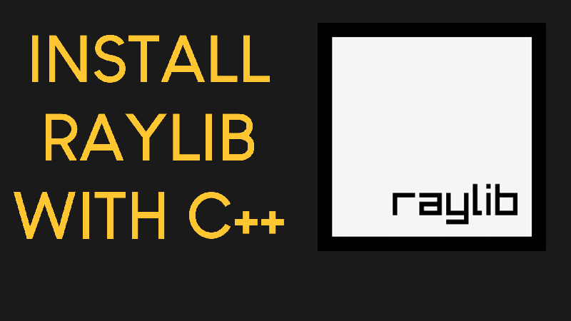

For current implementation, controls, pending decisions, and switching-device instructions, read [HANDOFF.md](HANDOFF.md).

## macOS development

Open `main.code-workspace` in VS Code. Apple Command Line Tools and Homebrew raylib are required:

```sh
xcode-select --install  # only if Command Line Tools are missing
brew install raylib   # only if raylib is missing
```

From this directory:

```sh
make -j4
./RougeSnake
make -j4 BUILD_MODE=DEBUG PROJECT_NAME=RougeSnakeDebug
```

From the parent repository directory, use `make -C Untitled -j4` and run with
`cd Untitled && ./RougeSnake`. The working directory must contain `map/` and `sprite/`.

VS Code: install Microsoft's C/C++ extension (`ms-vscode.cpptools`), then select
**Launch RougeSnake (macOS)** and press F5. This builds the debug executable and
uses LLDB. The default build task produces the release executable.

macOS objects are isolated under `obj/OSX/DEBUG` and `obj/OSX/RELEASE`, so copied
Windows objects are not reused. Header dependencies rebuild automatically.
`make clean` removes only the selected configuration's objects and executable;
for debug cleanup use `make clean BUILD_MODE=DEBUG PROJECT_NAME=RougeSnakeDebug`.
Homebrew's installed raylib is dynamically linked; this is a local development
build, not a standalone distribution.

---

# Raylib-CPP Starter Template for VS Code


A minimal C++ project scaffold for Visual Studio Code on Windows — includes a bouncing ball demo and zero boilerplate friction.

<p align="center">
  <a href="https://youtu.be/acvgbKRaxDI">
    
  </a>
</p>

<p align="center">
  <a href="https://youtu.be/acvgbKRaxDI">
    
  </a>
</p>

---

## Get started in 3 steps

**1.** Double-click `main.code-workspace` to open the project in VS Code.

**2.** In the Explorer panel, navigate to the `src/` folder and open `main.cpp`.

**3.** Press `F5` to compile and run.

---

## What's inside

| | Feature | Details |
|---|---|---|
| 📁 | **Clean folder structure** | All source code lives in `src/` for clear organisation |
| 🎱 | **Bouncing ball demo** | Ready-to-run example using raylib's core 2D drawing API |
| ⚙️ | **VS Code tasks** | Pre-configured build tasks — no manual setup required |
| ✅ | **Tested on Win 10/11** | Works with raylib 6.0 on both platforms out of the box |

---

## Quick look

```cpp
#include <raylib.h>
#include "ball.h"

int main()
{
    const Color darkGreen = {20, 160, 133, 255};

    constexpr int screenWidth = 800;
    constexpr int screenHeight = 600;

    Ball ball;

    InitWindow(screenWidth, screenHeight, "My first RAYLIB program!");
    SetTargetFPS(60);

    while (!WindowShouldClose())
    {
        ball.Update();

        BeginDrawing();
            ClearBackground(darkGreen);
            ball.Draw();
        EndDrawing();
    }

    CloseWindow();
}
```

---

## What's changed

The template now uses folders for better organisation. All source code lives in the `src/` folder.

---

## Resources

🎥 [Video Tutorial on YouTube](https://youtu.be/acvgbKRaxDI)
&nbsp;&nbsp;|&nbsp;&nbsp;
📺 [My YouTube Channel](https://www.youtube.com/channel/UC3ivOTE5EgpmF2DHLBmWIWg)
